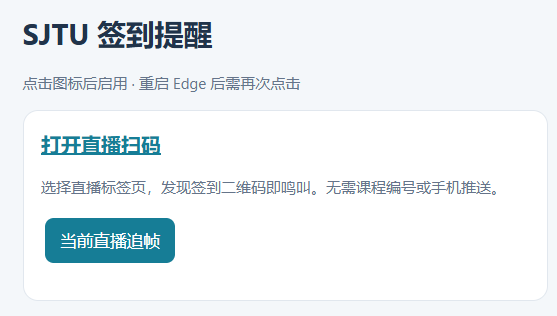
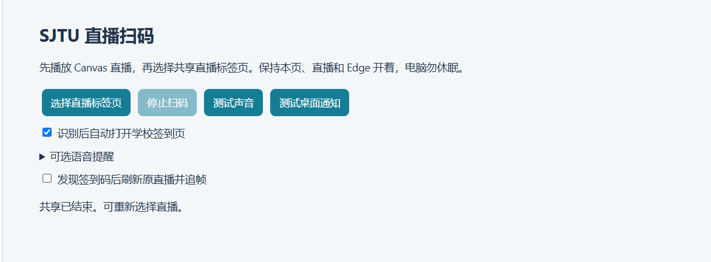
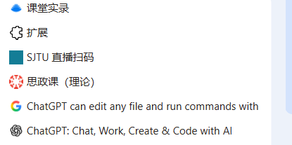
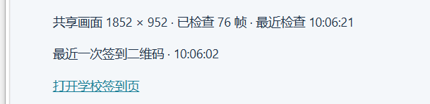
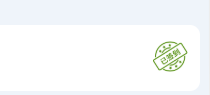

# SJTU 直播扫码新手教程

## 1. 下载和安装

[直接下载 Edge 安装包 1.1.19](https://raw.githubusercontent.com/determine123/SJTU_SignIn_Monitor/main/downloads/sjtu-signin-monitor-1.1.19.zip)

1. 下载 ZIP 并解压。
2. 在 Windows 的 Edge 地址栏输入 `edge://extensions`，开启「开发人员模式」。
3. 点击「加载解压缩的扩展」，选择解压后包含 `manifest.json` 的 `edge-signin-monitor` 文件夹。
4. 打开 Edge 工具栏的「扩展」菜单，找到「SJTU Canvas 签到提醒」。经常使用时可以将它固定到工具栏。

## 2. 打开课堂和扫码页

先在 Edge 打开并播放 Canvas 课堂直播。保持课堂标签页打开，点击扩展图标，再点击「打开直播扫码」。

在扫码页点「选择直播标签页」，选择正在播放课堂的标签页并确认共享。直播扫码无需填写课程编号或配置手机推送。默认使用二维码识别，只有需要语音提醒时才开启语音选项并共享音频。

在标签页列表中选择播放课堂的页面，例如「课堂实录」。「SJTU 直播扫码」是显示识别结果的页面。

## 3. 测试提醒并检查扫码状态

- 点击「测试声音」，确认本机能听到提示音。
- 点击「测试桌面通知」，确认 Windows 能显示提醒。此操作无需等待课堂出现签到码。
- 共享后查看「已检查」的帧数和「最近检查」时间。帧数持续增加说明扫码仍在处理画面。请保持 Edge、课堂和扫码页打开，并让电脑保持唤醒。

## 4. 查看识别和签到结果

扫码页会分别记录最近一次签到二维码和普通二维码。识别到签到码后，点击「打开学校签到页」可查看学校页面。开启自动打开时，Canvas 移动学习的签到链接会直接打开。交大独立签到系统的链接会留在扫码页供你打开。

在学校页面核对签到结果。下图是学校页面的成功印章示例。扩展显示「识别到签到二维码」只代表成功解码，签到结果以学校页面为准。

## 常见问题

| 情况 | 检查方法 |
| --- | --- |
| 已检查帧数不再变化 | 检查直播是否仍在播放、Edge 是否仍在共享课堂标签页。若共享已结束，重新选择课堂标签页。 |
| 有二维码但显示普通码 | 展开「最近一次普通二维码」查看内容。学校签到入口与普通二维码会分开显示。 |
| 桌面通知没有弹出 | 点击「测试桌面通知」，检查 Windows 是否允许 Edge 发通知，以及是否开启了免打扰。 |
| 录像识别到了旧签到码 | 录像里的二维码仍可被解码。能否签到以学校页面显示为准。 |
| 如何升级已有安装 | 把新版文件复制到原加载目录，在 `edge://extensions` 点击「重新加载」，再重新共享课堂标签页。 |

[返回仓库首页](../Readme.md)
